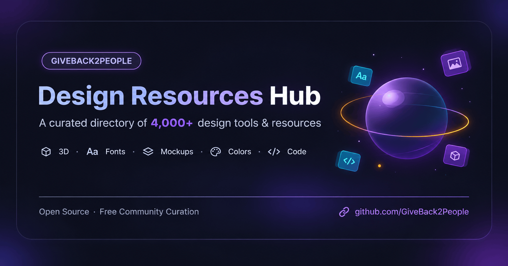

<p align="center">
  
</p>

# Design Resources Hub 🎨✨

[](https://github.com/GiveBack2People/designresources/actions/workflows/deploy.yml)
[](https://designresources.eu.cc/)
[](mailto:contact@designresources.eu.cc)
[](https://opensource.org/licenses/MIT)

Explore a curated collection of **4,000+ hand-picked design tools, assets, references, and frameworks** for graphic designers, UI/UX designers, developers, and creatives.

🚀 **[Browse the Gorgeous Live Website](https://designresources.eu.cc/)**

---

## 🌟 Features & Curation Categories

We have transitioned from simple markdown lists to a high-speed, search-driven, production-grade **VitePress web app**! You can search or navigate across 13 major design categories:

1. 💡 **[Design Inspiration](https://designresources.eu.cc/design-inspiration)** — Curated galleries, portfolios, award-winning sites, and graphic design blogs.
2. 📷 **[Stock Photos](https://designresources.eu.cc/stock-photos)** — Royalty-free high-res photography and AI image generators.
3. 🎵 **[Stock Video & Music](https://designresources.eu.cc/stock-video-music)** — Free footage, overlay packs, and royalty-free soundtracks.
4. 🖼️ **[Vectors & Illustrations](https://designresources.eu.cc/vectors-illustrations)** — Open-source SVG vectors, clipart, and pattern generators.
5. 🎨 **[Icons, Logos & Animations](https://designresources.eu.cc/icons-logos)** — Icon libraries, brand logo databases, and Lottie animations.
6. 📐 **[3D, Architecture & Motion](https://designresources.eu.cc/3d-architecture)** — 3D assets, OBJ/STL files, HDRI maps, interior architecture, and VFX assets.
7. 🔤 **[Typography & Fonts](https://designresources.eu.cc/typography)** — Free English & Bangla typefaces, Google Fonts, and pairing resources.
8. 🌈 **[Colors & Gradients](https://designresources.eu.cc/colors-gradients)** — Palette builders, gradient generators, contrast checkers, and brand hex palettes.
9. 📱 **[Mockups & Frames](https://designresources.eu.cc/mockups)** — Device mockups, packaging outlines, and screenshot styling tools.
10. 🖌️ **[Design Add-ons](https://designresources.eu.cc/design-addons)** — Photoshop brushes, Procreate assets, and texture packs.
11. 🛠️ **[Design Tools & AI](https://designresources.eu.cc/design-tools-ai)** — Vector editors, layout software, and generative AI systems.
12. 💻 **[Code & Frameworks](https://designresources.eu.cc/code-frameworks)** — UI libraries, CSS frameworks, JS plugins, and components for developers.
13. 📚 **[Learning & Community](https://designresources.eu.cc/learning-community)** — Tutorials, forums, and design communities.

---

## 🛠️ Running Locally

Want to host or preview the website locally?

1. **Clone the repository:**
   ```bash
   git clone https://github.com/GiveBack2People/designresources.git
   cd designresources
   ```

2. **Install dependencies:**
   ```bash
   npm install
   ```

3. **Start the local dev server:**
   ```bash
   npm run docs:dev
   ```
   Open `http://localhost:5173` in your browser to view the interactive design resource platform!

---

## 🤝 How to Contribute

This is a community-driven database! If you want to add high-quality links, update descriptions, or fix broken resources, please follow our **[Contribution Guidelines](docs/contributing.md)**. 

---

## ❤️ Credits & Methodology

This database is built for the community. The visual composition and interactive elements are powered by:
* **Canva** — Visual UI planning and floating 3D glassmorphism graphics design.
* **Antigravity (by Google DeepMind)** — Intelligent agentic compilation, spreadsheet ingestion pipeline, and custom layouts.

### 🤖 Automated Curation Pipeline

To compile and categorize over **4,000+ design resources** from external lists, crowd-sourced spreadsheets, and community submissions, we utilized automated Python ingestion scripts and AI agentic workflows. 
* **Data Extraction & Ingestion:** Python scripts parsed large, unstructured markdown files and Google Sheets datasets.
* **Categorization & Cleaning:** Links were automatically sorted, deduplicated, and formatted into clean Markdown tables for VitePress.
* **Hybrid Maintenance:** This automated foundation allows our community contributors to focus on quality curation rather than formatting syntax.

### Our Contributors

Many thanks to the incredible contributors who helped curate these links!

<a href="https://github.com/GiveBack2People/designresources/graphs/contributors">
  
</a>

---

## ⚖️ License

This project is licensed under the MIT License - see the [LICENSE](LICENSE) file for details.
